<picture>
  <source media="(prefers-color-scheme: dark)" srcset="./docs/assets/header-dark.svg">
  <source media="(prefers-color-scheme: light)" srcset="./docs/assets/header-light.svg">
  
</picture>

<p align="center">
  
  
  
  
</p>

**Sobel edge detection written twice, once in C++ and once in hand-written x64 assembly with SIMD instructions, behind a C# desktop app that benchmarks the two.** This was the project for *Assembly Languages* at the Silesian University of Technology.

<p align="center"></p>

## ⚙️ How it works

```text
C# WinForms  ──P/Invoke──►  SobelFilterDLL.dll (C ABI)
  load image                  ProcessGrayscale    24-bit BGR → 8-bit luma        C++, threads
  pick C++ / ASM              ProcessGaussian     3×3 blur [1 2 1]ᵀ[1 2 1]/16     C++, threads
  pick threads (1–64)         ProcessSobel_CPP    Sobel, 1 pixel per iteration   C++, threads
  run / benchmark             ProcessSobel_ASM    Sobel, 8 pixels per iteration  MASM, threads
  histogram, save
```

The Sobel operator approximates the image gradient with two 3×3 kernels, and edge strength is `|Gx| + |Gy|`, clamped to 255:

```text
      -1 0 1           1  2  1
Gx =  -2 0 2     Gy =  0  0  0
      -1 0 1          -1 -2 -1
```

### The assembly version

[`SobelASM.asm`](SobelFilterDLL/SobelASM.asm) computes **8 output pixels per iteration**:

1. `MOVQ` loads 8 neighbouring bytes for each kernel tap, and `PUNPCKLBW` widens them to 16-bit lanes so the sums cannot overflow.
2. The kernel needs no multiplications: the ×2 taps are `PSLLW 1` and the rest are `PADDW` and `PSUBW`. Each tap row is loaded once and reused by both Gx and Gy.
3. `PABSW` (SSSE3) gives the absolute values, and `PACKUSWB` packs back to bytes with unsigned saturation, which does the clamp to 255 for free.
4. The last block of each row is moved left to end exactly at the edge, so the right border gets processed without any scalar tail loop.

Rows are split into bands across `std::thread`s. The C++ and ASM paths use the same splitting, so a benchmark at N threads compares like with like.

## 📊 Benchmark

Median of 25 runs, Sobel step only, on a 3840×2160 image. Measured with the [Linux test harness](tests/run.sh) on a 2-vCPU Xeon @ 2.1 GHz (AVX2) with GCC 13:

| implementation | 1 thread | 2 threads |
|---|---|---|
| C++, `-O2` (scalar) | 16.6 ms | 8.4 ms |
| **ASM, SSE (8 px / iteration)** | **4.5 ms** | **2.0 ms** |
| C++, `-O3 -march=native` (auto-vectorised AVX2) | 2.8 ms | 1.5 ms |

* Hand-written SIMD is about **4× faster** than straightforward scalar C++, which is roughly what 8 lanes minus the widening and packing overhead should give.
* With `-O3 -march=native`, GCC auto-vectorises the plain C++ loop with **32-byte AVX2** registers and beats the 16-byte SSE assembly. The compiler is a strong baseline, and the next step for the assembly would be AVX2 with 16 pixels per iteration.
* The GUI's **Probe** button runs the same comparison on Windows for 1–64 threads and appends the averages to `benchmark.csv`.

## 🐛 Fixed during the clean-up

* **ABI violation:** the routine overwrote `XMM6`, `XMM7` and `XMM15`, which are callee-saved on Windows x64, so the caller's registers could be silently corrupted. They are now saved and restored. The harness checks this by calling through the real `ms_abi` convention.
* **Unprocessed right edge:** columns past the last full 8-pixel block were never computed, leaving a black stripe up to 8 px wide. Only 675 of 1,470 random test images matched the C++ output before the fix, and all 1,470 match now.
* **Unfair comparison:** the ASM path ignored the thread count and always ran on one thread, while C++ used up to 64. Both are now multithreaded the same way.
* Timings now cover only the native call, not bitmap allocation and locking. The benchmark CSV no longer goes to a hard-coded `C:\Users\…` path, the Release build no longer loses the DLL, and the header guards (`#endif` placed right after `#define`) are replaced with `#pragma once`.

## 🚀 Build & run

**Windows (the app):** open `SobelFilter.sln` in Visual Studio 2022 with the *Desktop development with C++* and *.NET desktop development* workloads, choose **x64**, and press F5. MASM ships with the C++ workload. The DLL and the GUI build into `bin\x64\<Configuration>\`, and *Load image* opens the [`samples/`](samples) folder.

**Linux (correctness + benchmark, no Visual Studio):**

```bash
tests/run.sh                                         # ASM vs C++ on 1,470 random images + ABI check
tests/run.sh samples/large_3840x2160.jpg             # + benchmark (python3 + Pillow to decode)
CXXFLAGS="-O3 -march=native" tests/run.sh samples/large_3840x2160.jpg
```

The script converts the MASM source to NASM with a few `sed` rules (the instructions are identical) and calls it through GCC's `ms_abi` attribute, so the exact Windows code path gets tested.

## 🗂️ Repository

```
SobelFilter.sln
SobelFilterDLL/   C++ pipeline (Grayscale, Gaussian, Sobel), SobelASM.asm, C exports (InterfaceDll.cpp)
SobelFilterGUI/   C# WinForms app: SobelEngine (P/Invoke + timing), Form1, HistogramForm
samples/          test images from 394×128 to 3840×2160
tests/            Linux harness: correctness, ABI check, benchmark
docs/             project presentation (PL), README assets
```
